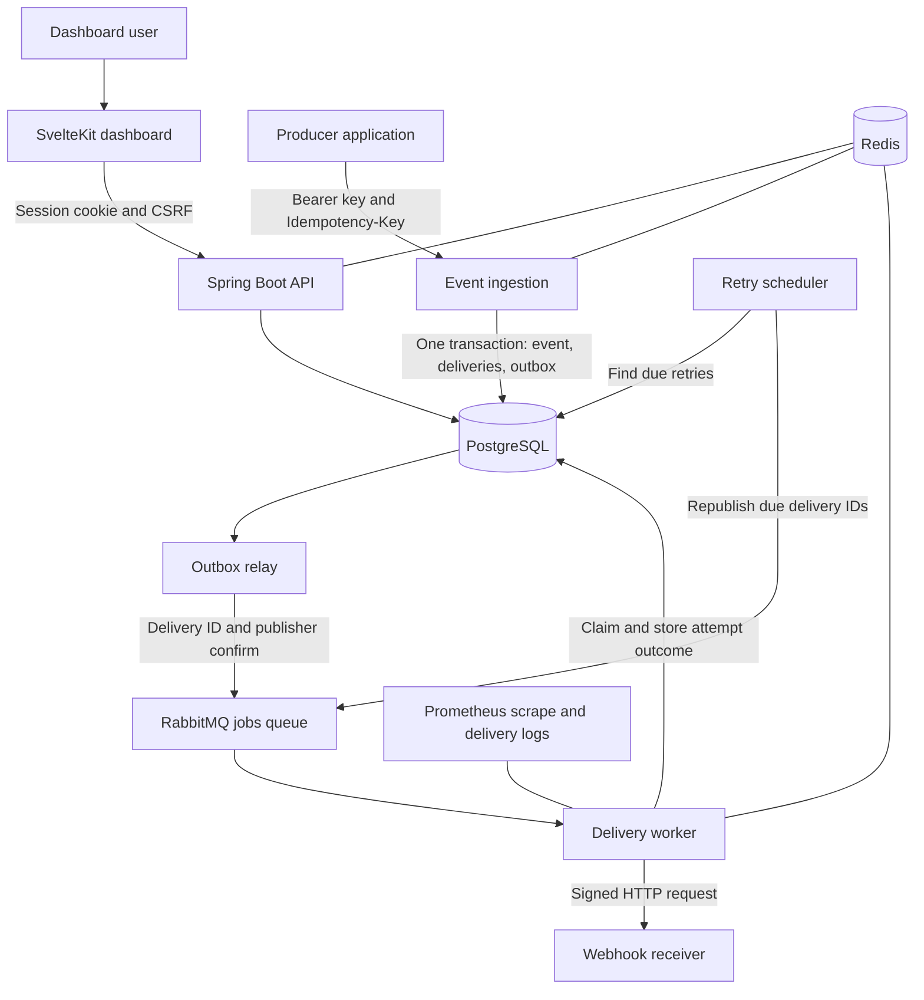

# NotifyFlow

A multi-tenant webhook delivery platform built with Java 21, Spring Boot 4.1.2,
and SvelteKit. Producers submit events once; NotifyFlow routes them to subscribed
endpoints, sends signed HTTP requests, and records delivery attempts.

The project demonstrates transactional messaging, concurrency control, failure
recovery, tenant isolation, and a dashboard for operating the delivery workflow.

**Status:** local development, container builds, and GitHub Actions CI are working.
An on-demand HTTPS demo through Cloudflare Tunnel is verified. There is no
permanent, always-on demo URL.

## What it does

- Workspaces with administrator/viewer memberships and tenant-scoped access.
- Session authentication and CSRF protection for human users; revocable, hashed
  producer API keys for event ingestion.
- Event-type subscriptions that route one event to multiple webhook endpoints.
- Tenant-scoped idempotency: replaying a key with matching content returns the
  existing event; conflicting content returns HTTP 409.
- Transactional outbox with RabbitMQ publisher confirms and recoverable publication.
- HTTP attempt history, scheduled retries with backoff, retry limits, manual replay,
  and a dead-letter queue for malformed delivery jobs.
- HMAC-SHA256 signatures, overlapping signing-secret rotation, and destination
  address checks at registration and connection time.
- Redis endpoint rate limiting, endpoint caching, and event idempotency caching.
- Dashboard views for endpoints, subscriptions, producer keys, deliveries, and attempts.
- Prometheus send counters/timing and delivery logs with correlation identifiers.

## Architecture



PostgreSQL is authoritative for events, delivery state, attempt history, and outbox
messages. Redis supplies caches and rate-limit coordination. RabbitMQ carries
delivery IDs; the worker loads the current delivery data from PostgreSQL.

Outbox publication is at least once. Duplicate jobs are expected, and delivery
claims use row locks and status checks. This is not an exactly-once guarantee for
remote HTTP side effects: receivers should verify signatures and deduplicate by
the stable delivery ID.

## Example flow

1. Register and create a workspace, then create a webhook endpoint.
2. Subscribe the endpoint to `order.created` and create a producer key.
3. Submit an event with a unique idempotency key:

   ```http
   POST /api/producer/events
   Authorization: Bearer <producer-api-key>
   Idempotency-Key: <unique-request-key>
   Content-Type: application/json

   {"type":"order.created","payload":{"orderId":128}}
   ```

4. The API accepts the event with HTTP 202 and commits the event, matched
   deliveries, and outbox messages together.
5. The relay publishes delivery jobs; workers send signed webhook requests.
6. Inspect response codes and attempts in the dashboard. Retryable failures are
   scheduled automatically; failed deliveries can be replayed by an administrator.

No subscriptions means the event can be accepted without creating deliveries.
Producer keys grant event publishing, not endpoint administration.

## Run locally

Requirements: Java 21, Node.js 24/npm, and Docker Desktop with Linux containers.
The repository includes the Maven wrapper.

Follow the [local development guide](docs/local-development.md) for password
configuration and backend/frontend startup. Infrastructure can be started with:

```powershell
Copy-Item .env.example .env  # First setup only; fill in your own passwords.
docker compose up -d --wait
docker compose ps
```

The development stack uses PostgreSQL on 5435, RabbitMQ on 25673, its management
UI on 15673, and Redis on 16379. The documented backend port is 7829 and the
frontend development server normally uses 5173. Existing named volumes are reused.

For the complete application in Docker, package the backend first, then start the
combined stack:

```powershell
.\mvnw.cmd package -DskipTests
docker compose -f compose.yml -f compose.app.yml up -d --build
```

Open http://localhost:8088. Caddy routes the dashboard and `/api` through one
address; frontend and backend listen only on the internal Docker network. See
[container startup details](docs/local-development.md#run-the-applications-in-docker)
for configuration, logs, and shutdown.

## Checks and CI

From the repository root, with Docker running:

```powershell
.\mvnw.cmd clean verify
```

From `frontend`:

```powershell
npm ci
npx playwright install chromium
npm run check
npm test
npm run build
```

Backend integration tests use isolated Testcontainers services. Frontend component
tests use headless Chromium with mocked API requests. GitHub Actions runs backend
verification and frontend checks in separate jobs on pushes and pull requests.
Both jobs include an image build; images are not published or deployed by CI.

View [CI runs](https://github.com/wengyhong/notifyflow/actions/workflows/ci.yml).

## Demo and technical notes

- [Portfolio demo walkthrough and screenshot plan](docs/portfolio-demo.md)
- [Temporary HTTPS demo with Cloudflare Tunnel](docs/cloudflare-tunnel.md)
- [Authentication, tenant isolation, and producer keys](docs/authentication.md)
- [RabbitMQ and dead-letter handling](docs/rabbitmq.md)
- [Transactional outbox](docs/outbox.md)
- [Retry history and manual replay](docs/manual-replay.md)
- [Signing, secret rotation, and destination restrictions](docs/webhook-security.md)
- [Redis rate limiting](docs/redis-rate-limiting.md)
- [Endpoint caching](docs/endpoint-caching.md)
- [Idempotency caching](docs/idempotency-caching.md)
- [Metrics and delivery logs](docs/observability.md)
- [Frontend implementation and tests](frontend/README.md)
- [Deployment review and remaining work](docs/deployment-review.md)

## Current scope

This is a portfolio application with Java and Node runtime images, a SvelteKit
Node adapter, and a Compose gateway verified locally over HTTP and through a
temporary HTTPS tunnel. Backend and frontend image-build checks passed on GitHub.
Infrastructure as code and an always-on hosted environment remain deployment
work; the tunnel runs the application on your computer. Login sessions currently
live in the servlet container; multiple backend replicas would require an explicit
session strategy. The dashboard refreshes history manually.

The local profile intentionally allows loopback webhook receivers and exposes
health/metrics on a separate loopback-only listener. It is a development profile,
not the public deployment configuration.
